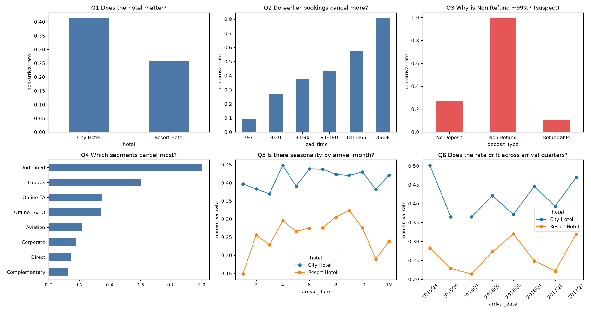
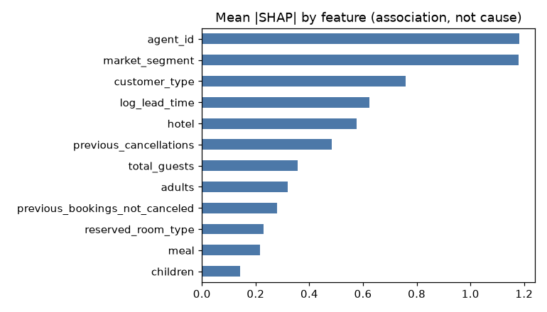

# The hotel model that looked great until I asked when each number was recorded

*A CRISP-DM walkthrough with a failed pilot-readiness test, a leaky dataset and
two AI reviewers who would not let me cut corners.*

**[Links to add: Colab notebook · GitHub repo · live app · walkthrough video]**

About 37% of hotel bookings never turn into a stay. If a revenue manager knew
which ones, they could phone those guests, offer a free date change, and save
some of the revenue. I tried to build that on the public *Hotel booking demand*
dataset (119,390 bookings from a city hotel and a resort in Portugal, 2015 to
2017) and followed CRISP-DM step by step. The honest summary: the model works, the
business case is unproven, and the most important result was something the
model should *not* use.

## Phase 1: decide what "good" means before touching data

Accuracy is the wrong yardstick. A phone call costs money, and a saved booking
earns money. With three assumed numbers (€20 per outreach, a 25% save rate, €150
lost per unrecovered non-arrival) the break-even is simple: call a guest only if
the probability of non-arrival is above 20 / (0.25 × 150) = 0.53. I wrote that,
plus ten pass/fail criteria, down *before* modeling. Several of them later
failed, which is exactly why you write them first.

## Phase 2: the column that gave the game away

Non-arrival rises from 10% for bookings made within a week of arrival to 81%
for bookings made more than a year ahead. Useful. But two other findings
mattered more:

- **`required_car_parking_spaces` is above zero for 10% of guests who arrived and
  for exactly 0.0% of guests who did not.** A parking space is only recorded for
  people who show up. The dataset is a snapshot taken the day before arrival, so
  several columns (room assigned, booking changes, parking, special requests)
  describe the stay, not the booking.
- `deposit_type = Non Refund` is 99.25% non-arrival, concentrated in group
  bookings and a handful of agents. That is commercially absurd, so I treated it as
  a likely recording artifact and kept it out.

I split the columns into Set A (fixed by the reservation) and Set B (not shown to
be known at booking). Later, adding Set B lifted PR-AUC from 0.75 to 0.85. A model
built on it would have looked brilliant and been useless at the moment a hotel
needs it.

## Phases 3 and 4: honest validation

Rows were split by arrival date (a random split would flatter any model), with
the final 20% fixed by date before analysis and opened once for predictions (I had glimpsed aggregate test outcomes
during early exploration, and I say so in the repo). Preprocessing lived in one scikit-learn pipeline
fit on training rows only. Logistic regression (PR-AUC 0.71) was neck and neck
with tuned LightGBM (0.72). The criterion I had set, that the boosted model must
clearly beat the linear one, *failed*, and the pre-set selection rule picked
logistic regression.

## Phase 5: opening the test

| | Logistic regression | Lead-time rule |
|---|---|---|
| Precision of flagged bookings | 0.72 | 0.51 |
| Recall | 0.39 | 0.21 |
| Net benefit per 1,000 bookings | €1,533 | -€160 |

Good news: the model separates risk and beats the naive rule. Bad news, in order of
importance:

1. **Profit depends on numbers I made up.** Below a 19% save rate the policy loses
   money. No dataset can tell you that. A randomized pilot can.
2. **Summer broke it.** Precision fell from 0.90 in April to about 0.52 in July and August.
3. **It is not equally fair.** German guests who would have arrived were contacted
   wrongly 3.1 times as often as Portuguese guests.
4. LightGBM, frozen before the test, did better (+€489 per 1,000). Because I
   learned that from the test, I run it as a shadow challenger and do not crown it.

My decision: **no-go for automation, conditional go for a randomized pilot**
with about 710 flagged non-Group bookings per arm, running through July and August.

## Phase 6: ship the thing, with its warnings

A Streamlit app scores one booking or a CSV, shows the probability and the
recommended action, and warns on July-August dates. A monitoring module tracks
drift (PSI) and flagged precision. In a replay of the test stream, weekly
*aggregate* calibration stayed fine while the flagged set degraded, so the
precision alert is what catches it.

## How two AIs kept me honest

Claude drafted each phase; GPT-5.6, prompted as a world-renowned CRISP-DM
authority, reviewed it in a fresh context, two to four rounds per phase. The
reviews caught things I would have shipped: a "booking-time" claim the data could not support, no-shows hiding in
the target, my own peek at test-period outcomes, a duplicate rule that leaked
future rows, and a pilot sample size that didn't match its stopping rule. Scores
climbed from 4/10 to 9+ over the rounds. Everything the reviewers said is in the
repo, with what I accepted and why.

## What I would do differently

Choose models by average fold-level *net benefit* instead of one validation
segment; validate by season; seal the test set in code before looking at any
outcome; and read the dataset paper's field definitions on day one.

*All code, notes and reviews: [GitHub link]. The assumed costs are examples, not
hotel data.*
