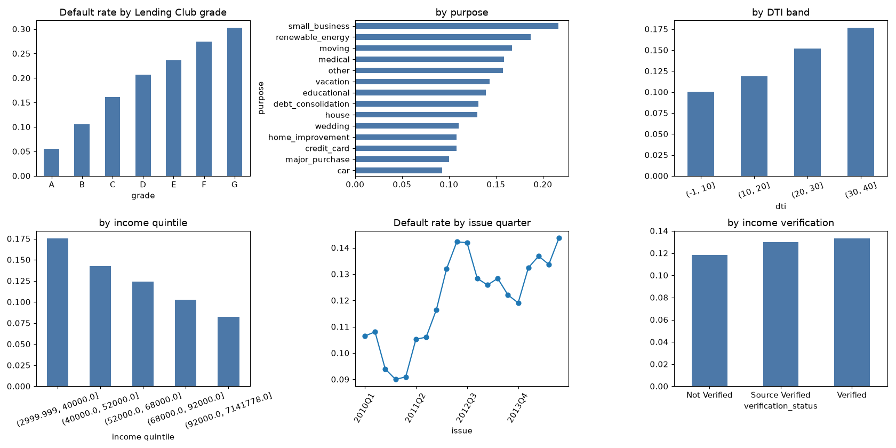
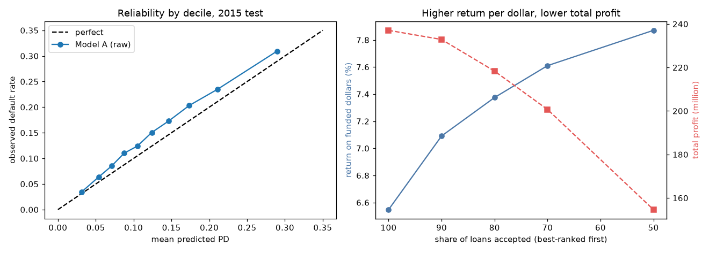

# A credit-risk model that ranks borrowers well and still doesn't earn you more

*A SEMMA walkthrough on 2.26 million Lending Club loans, with a leaky column, a test I could not
call sealed, and a profit result I did not expect.*

**[Colab notebook](https://colab.research.google.com/github/olegm-sjsu/Data-Mining/blob/main/Data-Science-Methodologies/02_SEMMA_LendingClub-Default/notebooks/semma_lending_club.ipynb) · [GitHub repo](https://github.com/olegm-sjsu/Data-Mining/tree/main/Data-Science-Methodologies/02_SEMMA_LendingClub-Default) · [Walkthrough video](https://youtu.be/sDaF-TPgXS8)**

Everyone knows the recipe: predict who will default, decline them, make more money. I tried it
on all of Lending Club's accepted loans (2007 to 2018), following SAS's SEMMA stages (Sample,
Explore, Modify, Model, Assess). The model works. The recipe does not.

## Sample: throw away what hasn't finished

Of 2.26 million rows, 912,569 are still open, and a loan issued in 2016 that has already ended
tells you mostly about the ones that ended early (often charged off). So I kept only loans that
*could* have run to term by the end of the data: 36-month loans issued by December 2015. That leaves 666,785
loans and a clean out-of-time test: all 282,787 loans issued in 2015, not sampled, so no outcome-based selection touched it.

A learning curve told me the truth about "how big a sample?": validation AUC climbed from 0.625
to 0.684 across the whole range and never flattened. So I used every training loan.

## Modify: 41 columns that know the future

The file has 151 columns. Forty-one are filled in *after* the loan starts: payments received,
recoveries, the borrower's refreshed FICO. `recoveries` alone has a single-column AUC of 0.93. Feed
those to a model and it looks like a genius and is worthless at the moment you decide. I audited
every column, kept ZIP code and state out of the model (proxies for protected groups), and
compared models with and without Lending Club's own grade and rate.

## Model and Assess

LightGBM on application and credit-bureau data won, with a test ROC-AUC of **0.679** (my
pre-set target was 0.68: a miss by 0.0007, and I report it as a miss). The riskiest tenth of loans defaults at 31%
versus 3% for the safest, and holds a fifth of all defaults. It is stable: score PSI 0.007.

Then the surprises:

1. **It under-predicts.** It predicts 12.9% default for 2015; 14.9% happened. The ranking holds,
   the levels drift.
2. **Declining risky loans doesn't help.** Using realized cash flows (what investors actually
   received), the riskiest decile *still returned +1.3%*. Lending Club's rates already price risk.
   Accepting only the best half raises return per dollar from 6.6% to 7.9%, but total profit falls from
   $237 million to $155 million.
3. **A fairness flag.** If you decline the riskiest 20%, the lowest-income quartile is approved at 63% of the
   top quartile's rate. That follows real risk, and is still something a lender has to justify.

## What the model is good for

Pricing and limit setting, not a stand-alone decline rule. I shipped a batch scoring script that
rejects malformed rows with reasons, monitoring code that fires on the same calibration gap I found,
and a SAS score-code export of the scorecard (I could not get SAS access, so it is generated but has not
been run in SAS).

## How two AIs kept me honest

Claude drafted each stage and GPT-5.6, prompted as a world-renowned SEMMA authority, reviewed it in a
fresh context, two to three rounds each. They caught that I called the test "sealed" after having seen
its aggregate default rate (it is held out, not sealed), that I sampled the test by outcome, and a bug that gave a constant predictor a nonzero
KS. All of it, with what I accepted and why, is in the repo.

*Costs and profit here use realized cash flows: undiscounted, no fees, declined loans earn nothing. They
compare rankings; they are not a forecast of a lender's return.*
