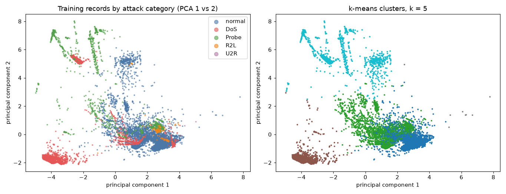
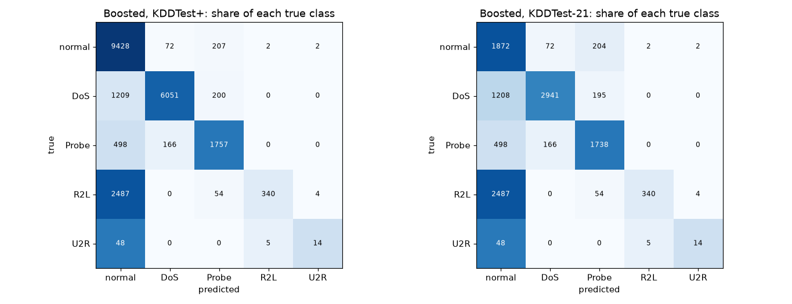

# The intrusion detector that was 99.9% accurate until it met something new

*A KDD walkthrough on NSL-KDD: what patterns separate attacks from normal traffic, and do they hold for attack types the model never saw?*

**[Colab notebook](https://colab.research.google.com/github/olegm-sjsu/Data-Mining/blob/main/Data-Science-Methodologies/03_KDD_NSL-KDD-Intrusion/notebooks/kdd_nsl_kdd.ipynb) · [GitHub repo](https://github.com/olegm-sjsu/Data-Mining/tree/main/Data-Science-Methodologies/03_KDD_NSL-KDD-Intrusion) · [Walkthrough video](https://youtu.be/Y5Y1Hvx6ipc)**

A random train/validation split says my classifier is 99.9% accurate (macro-F1 0.97). On the official test set the same model gets
78% accuracy and macro-F1 0.60. Nothing is wrong with the code. The test set is *designed* to be different, and the gap is the interesting
result. (The data is simulated traffic from 1998. I make no claim about modern networks.)

## Selection: read the test set's design before you model

NSL-KDD is a cleaned version of KDD Cup 99 (duplicates removed, records sampled by difficulty). Its test file contains **17 attack types that
never appear in training** (3,750 records, 29% of the test's attacks), and its class mix is nothing like the training mix: remote-to-local attacks (R2L) are 0.8% of
training and 12.8% of the test. The last column, `difficulty`, is derived from how classifiers performed on each record, so it can never be a feature.

## Validation that knows about novelty

I wrote down my success conditions first (five knowledge goals), then built two validation views from training data only: a random split, and one where I
held out *whole attack types* (`back`, `teardrop`, `nmap`, `warezclient`, ...) to simulate "never seen". Every scaler, PCA and cut point was refit inside each view,
and the model-selection rule, including its tie-break, was fixed before looking at results.

## What the mining found

- **Real, transferable patterns.** Half-open connections (`flag=S0`) with high SYN-error rates: a SYN flood (89 to 100% confidence on the test). Many ICMP echo
  requests across many hosts: a ping sweep (98 to 100%).
- **Clusters only half line up with categories** (NMI 0.48 on training, 0.30 on the test). Normal and DoS separate; R2L and U2R hide inside the normal cluster.
- **A detector trained only on normal traffic** ranks attacks well (AUC 0.96, novel types 0.95) but at a strict 1% false-alarm budget it flags only 10% of novel attacks. Accept 5% false alarms
  and it catches 67% of novel and 76% of known attacks.

## What the test showed

| `KDDTest+`, boosted model | Recall |
|---|---|
| DoS | 0.81 |
| Probe | 0.73 |
| **R2L** | **0.12** |
| U2R (67 records) | 0.21 |

Most R2L (2,487 of 2,885) is called normal. `guess_passwd` has 53 training records and 1,231 test records; the model finds none of them. The rules I mined for R2L describe
`warezclient`, which does not even occur in the test, so they do not transfer. And three novel attacks (`mailbomb`, `snmpguess`, `snmpgetattack`) were missed completely by both
the classifier and the anomaly detector.

All four pre-registered knowledge goals failed their conditions, and the notes say so: one by 0.014.

## Deployment: honest by construction

A FastAPI service returns the category, an anomaly score and the matched rules, with strict input validation and a model-hash check; I tested it through HTTP and in a Docker container.
The monitoring demo is a lesson on its own: treating the test as a live stream, only a drift *watch* message on one unrelated feature fires, and **no alert-volume trigger**, although R2L recall is 12%. Only labelled feedback can see a class-mix shift.

## How two AIs kept me honest

Claude drafted each step; GPT-5.6, prompted as a world-renowned KDD authority, reviewed it in a fresh context, two to three rounds each. They caught a pipeline fit on all training data inside
validation, a goal judged only on training data, and a missing tie-break in my selection rule. I then found, myself, that my selection code had not applied the tie-break I had written down:
I disclose that, along with the fact that the test had already been scored once. All the reviews are in the repo.

*Everything here is about a 1998-derived simulation.*
