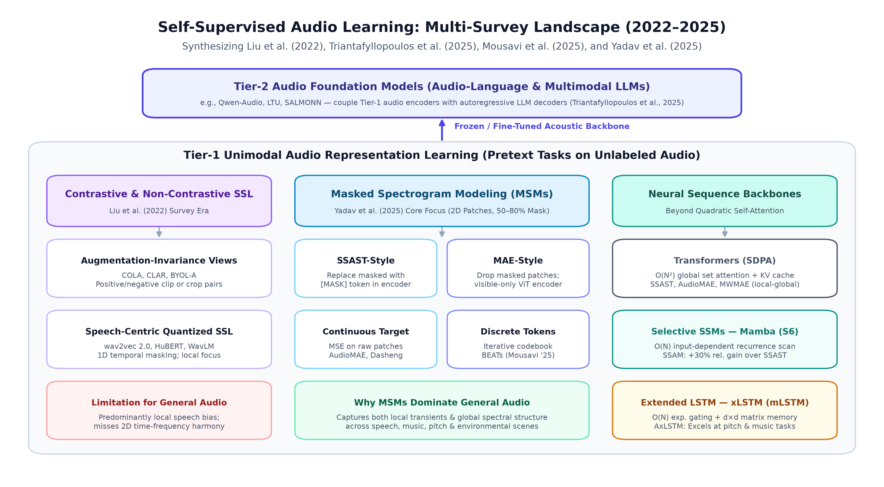
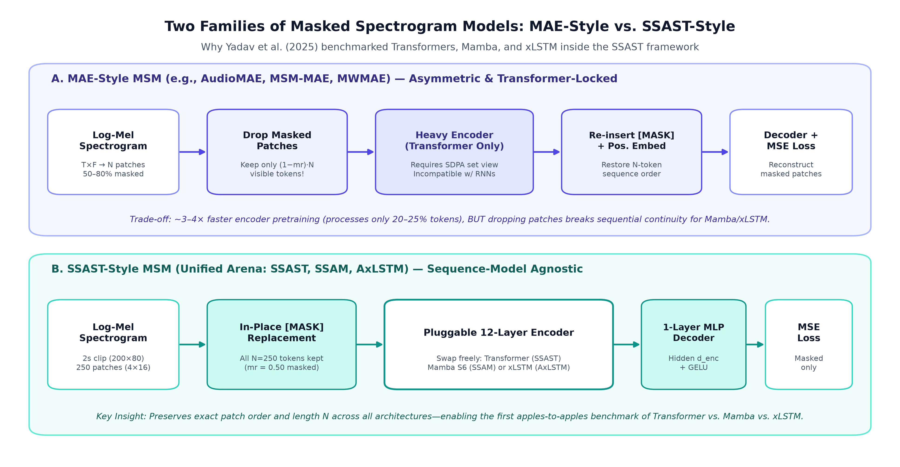
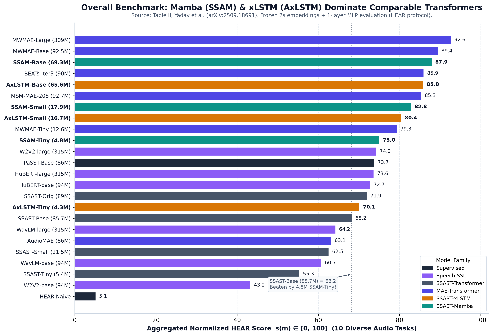
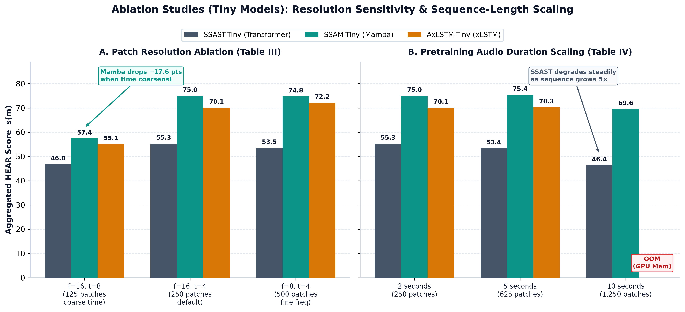

# Beyond Self-Attention in Audio AI: Self-Supervised Masked Spectrograms, Mamba, and xLSTM

**SJSU CMPE 255 (Data Mining) — Research Short Story**

A multi-survey deep dive and architectural synthesis centered on Yadav, Theodoridis, and Tan (2025), *"An overview of neural architectures for self-supervised audio representation learning from masked spectrograms"* ([arXiv:2509.18691](https://arxiv.org/abs/2509.18691)), enriched with broader audio self-supervised learning and foundation model surveys (Liu et al., 2022; Ericsson et al., 2022; Triantafyllopoulos et al., 2025; Su et al., 2025; Mousavi et al., 2025).

---

## Project Links

| Resource | Link |
| :--- | :--- |
| **Primary Paper** | [arXiv:2509.18691 — Yadav, Theodoridis & Tan (2025)](https://arxiv.org/abs/2509.18691) ([Local PDF](research-paper/2509.18691v1.pdf)) |
| **Medium Article** | [Draft & Full Text (Markdown)](medium-article/medium_article.md) · [Word Doc](medium-article/medium_article.docx) *(publish link to be added after Medium publish)* |
| **Slide Deck** | [PowerPoint (.pptx)](slides/audio_ssl_short_story.pptx) · [PDF Deck (.pdf)](slides/audio_ssl_short_story.pdf) · [Interactive HTML](slides/audio_ssl_short_story.html) *(SlideShare link to be added after upload)* |
| **Course Directory** | `Short-Story-Masked-Spectrogram-Audio-SSL/` in [`olegm-sjsu/Data-Mining`](https://github.com/olegm-sjsu/Data-Mining) |

---

## Executive Summary: What Is the Story About?

Modern audio AI faces a fundamental tension: labeling soundscapes at scale is prohibitively expensive, so **Self-Supervised Learning (SSL)** has become the standard engine for **Tier-1 audio foundation models** (Triantafyllopoulos et al., 2025). Unlike speech-only models (`wav2vec 2.0`, `HuBERT`) that emphasize short local frames, general-purpose audio models must capture both **sharp local transients** and **broad harmonic/temporal context** across speech, music, and environmental sound.

**Masked Spectrogram Modeling (MSM)** tackles this by converting audio into 2D log-mel spectrograms, dividing them into non-overlapping patches, masking **50–80%** of those patches, and training an encoder-decoder to reconstruct what is missing. Until recently, **Transformers** owned this space — despite their **$O(N^2)$ attention complexity** and growing Key-Value caches.

Yadav et al. (2025) deliver the first depth-matched, apples-to-apples benchmark comparing **Transformers (`SSAST`)**, **Selective State Space Models / Mamba (`SSAM`)**, and **Extended LSTMs (`AxLSTM`)** inside a unified SSAST-style MSM framework across **10 diverse HEAR downstream tasks**.



---

## Key Architectural Insights & Findings

### 1. Why the SSAST Framework Was Essential for a Fair Test
* **MAE-style MSMs** (`AudioMAE`, `MSM-MAE`, `MWMAE`, `Dasheng`) physically drop 75–80% of masked patches from the encoder, slashing pretraining compute by ~3–4×. However, dropping patches only works because Transformer self-attention treats inputs as an **unordered set**.
* **Mamba and xLSTM** are recurrent sequence models whose state transitions break if intermediate steps vanish. Replacing masked patches in-place with learnable `[MASK]` tokens (**SSAST-style**) preserves sequence order $N$, creating an unbiased arena across all three paradigms.



### 2. Headline Benchmark Performance (HEAR 10-Task Normalized Score $s(m) \in [0, 100]$)
* **Mamba (`SSAM`) dominates comparable Transformers (`SSAST`) by ~30% relative:**
  * `SSAM-Tiny` (**4.8M params**) scores **`75.0`**, beating `SSAST-Tiny` (5.4M, `55.3`) by +19.7 points and even outperforming `SSAST-Base` (**85.7M params**, `68.2`).
  * `SSAM-Base` (**69.3M params**) reaches **`87.9`**, surpassing larger MAE-style standard-Transformer models including `AudioMAE` (`63.1`), `MSM-MAE-208` (`85.3`), and discrete-token `BEATs-iter3` (`85.9`) under frozen HEAR probing.
* **Domain Specialization Emerges Between Recurrent Families:**
  * **Mamba (`SSAM`)** leads **Speech & General Audio** (Crema-D emotion `70.3`, VoxLingua107 `50.4`, SpeechCommands `87.9`, ESC-50 `81.0`).
  * **xLSTM (`AxLSTM`)** leads **Music & Pitch** (NSynth Pitch `71.4`, Mridangam Tonic `97.5`, Beijing Opera `93.6`), aided by its $d \times d$ matrix key-value memory.
* **Local-Global Attention Remains the Top Overall Ceiling:** `MWMAE-Base` (`89.4`) and `MWMAE-Large` (`92.6`) stay ahead by replacing standard global attention with **multi-window local-global attention**.



### 3. Ablation Highlights: Resolution & Sequence-Length Traps
* **Time Granularity Matters for Mamba:** Coarsening temporal patches ($t=4 \rightarrow 8$, 125 patches) drops `SSAM-Tiny` by **−17.6 points** (`75.0 → 57.4`). Conversely, finer frequency resolution ($f=16 \rightarrow 8$, 500 patches) boosts `AxLSTM-Tiny` (`70.1 → 72.2`).
* **Duration Scaling (2s $\rightarrow$ 5s $\rightarrow$ 10s):** `SSAST-Tiny` degrades monotonically (`55.3 → 53.4 → 46.4`), `SSAM-Tiny` peaks at 5s (`75.4`) and holds `69.6` at 10s, while `AxLSTM-Tiny` hits **Out-of-Memory (OOM)** at 10s (1,250 patches) without tiled GPU kernels.



---

## My Two Cents (Critical Perspective)

1. **Frozen Probing $\neq$ End-to-End Fine-Tuning:** HEAR's frozen 2s mean-pooling protocol measures plug-and-play representation quality, which heavily penalizes `AudioMAE` (`63.1`) compared to its fine-tuned AudioSet performance.
2. **MAE's Compute Lock-In:** Until masked-skipping scans exist for SSMs/xLSTMs, MAE-Transformers keep a ~4× pretraining compute advantage at 1B+ scale (e.g., `Dasheng`).
3. **Unidirectional Beat Bidirectional:** Unlike Vision Mamba/ViL, bidirectional scans did *not* improve audio MSM performance in Yadav et al.'s ablations—time asymmetry matters in sound.
4. **Hybrid Local-Global Is the Endgame:** Combining linear-time SSM sweeps with sparse/windowed attention and `BEATs`-style semantic token targets is the clearest blueprint for next-generation Tier-1 encoders feeding Tier-2 Audio-LLMs.

---

## Repository Structure

```
Short-Story-Masked-Spectrogram-Audio-SSL/
├── README.md                                  # This project overview, takeaways, and links
├── research-paper/
│   └── 2509.18691v1.pdf                       # Yadav et al. (2025) survey & benchmark paper
├── figures/                                   # 7 high-res (300 DPI) custom diagrams & data charts
│   ├── 01_audio_ssl_survey_taxonomy.png
│   ├── 02_ssast_vs_mae_architecture.png
│   ├── 03_transformers_vs_mamba_vs_xlstm.png
│   ├── 04_hear_benchmark_overall_scores.png
│   ├── 05_task_domain_heatmap.png
│   ├── 06_ablation_patch_and_duration.png
│   └── 07_efficiency_vs_accuracy_tradeoff.png
├── medium-article/
│   ├── medium_article.md                      # Original ~3,200-word article synthesized across surveys
│   └── medium_article.docx                    # Formatted Word export with embedded figures for Medium
└── slides/
    ├── audio_ssl_short_story.pptx             # 15-slide 16:9 PowerPoint deck with speaker notes
    ├── audio_ssl_short_story.pdf              # 15-slide 16:9 PDF export (for SlideShare / viewing)
    ├── audio_ssl_short_story.html             # Interactive browser slide deck
    └── presentation_outline.md                # Slide-by-slide outline & speaking notes
```

---

## References

* **Primary Paper:** Yadav, S., Theodoridis, S., & Tan, Z.-H. (2025). *An overview of neural architectures for self-supervised audio representation learning from masked spectrograms*. [arXiv:2509.18691](https://arxiv.org/abs/2509.18691).
* **Related Surveys Synthesized:**
  * Liu, S., et al. (2022). *Audio Self-supervised Learning: A Survey*. Patterns, 3(12), [arXiv:2203.01205](https://arxiv.org/abs/2203.01205).
  * Ericsson, L., Gouk, H., Loy, C. C., & Hospedales, T. M. (2022). *Self-Supervised Representation Learning: Introduction, Advances, and Challenges*. IEEE Signal Processing Magazine, [arXiv:2110.09327](https://arxiv.org/abs/2110.09327).
  * Triantafyllopoulos, A., et al. (2025). *Computer Audition: From Task-Specific Machine Learning to Foundation Models*. Proceedings of the IEEE, [arXiv:2407.15672](https://arxiv.org/abs/2407.15672).
  * Su, Y., Bai, J., Xu, Q., Xu, K., & Dou, Y. (2025). *Audio-Language Models for Audio-Centric Tasks: A Systematic Survey*. [arXiv:2501.15177](https://arxiv.org/abs/2501.15177).
  * Mousavi, P., et al. (2025). *Discrete Audio Tokens: More Than a Survey!* [arXiv:2506.10274](https://arxiv.org/abs/2506.10274).
* **Core Benchmarks & Architectures:** `SSAST` (Gong et al., 2022), `AudioMAE` (Huang et al., 2022), `MSM-MAE` (Niizumi et al., 2022), `BEATs` (Chen et al., 2023), `MWMAE` (Yadav et al., 2024), `Dasheng` (Dinkel et al., 2024), `Mamba` (Gu & Dao, 2023), `xLSTM` (Beck et al., 2024), `HEAR` (Turian et al., 2022).
