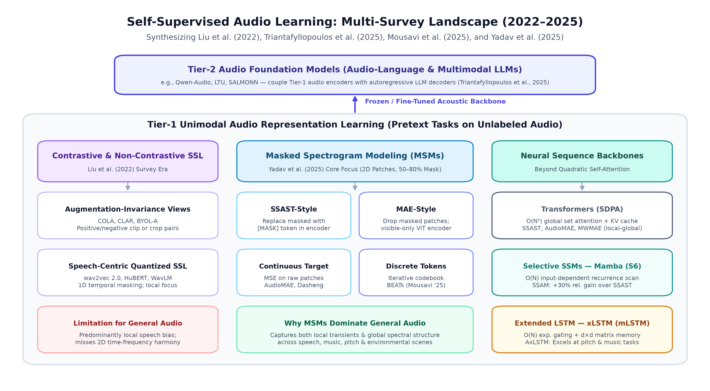
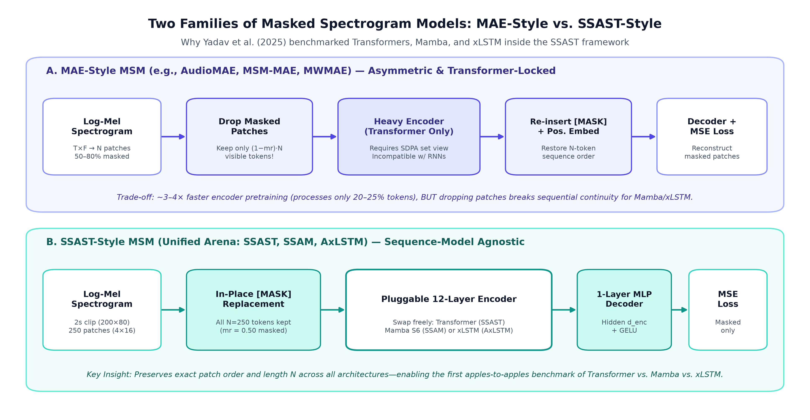
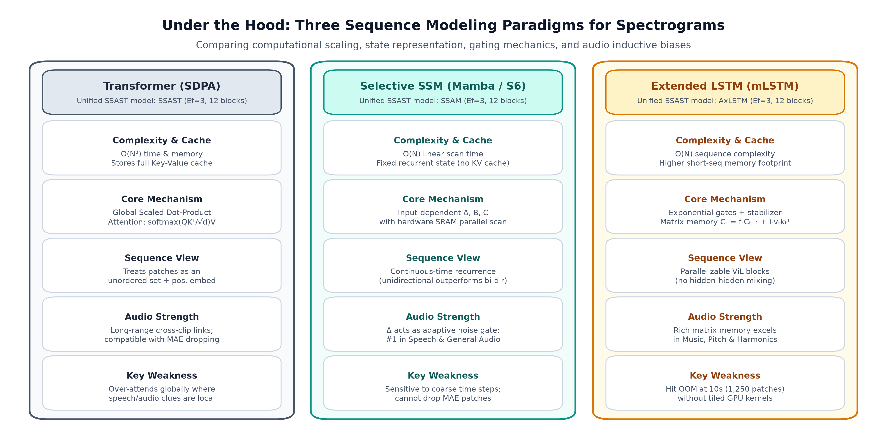
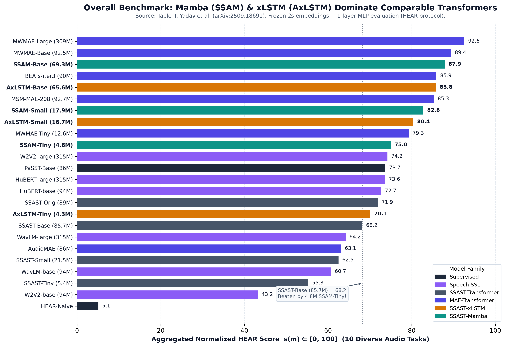
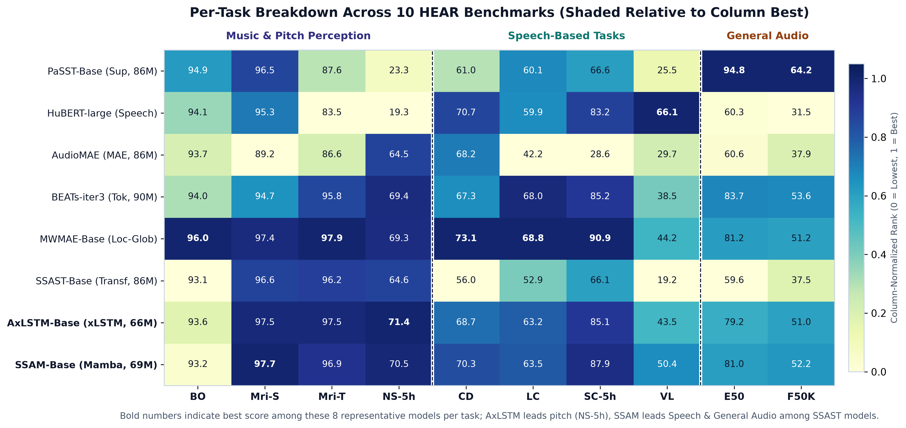
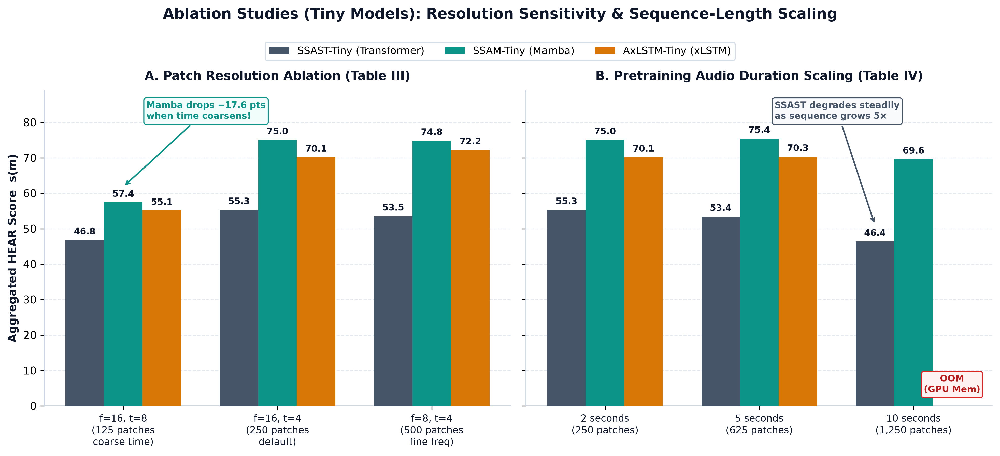
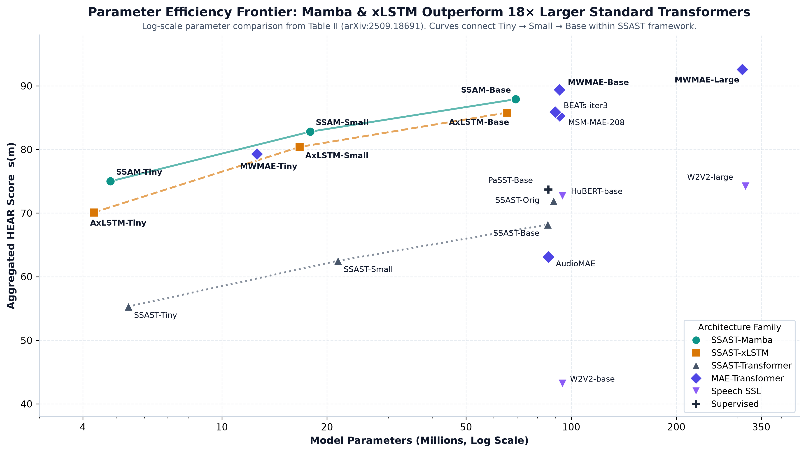

# Beyond Self-Attention in Audio AI: How Masked Spectrograms, Mamba, and xLSTM Are Reshaping Sound Representation

*A synthesis of recent audio self-supervised learning surveys — centered on Yadav, Theodoridis, and Tan (2025) — exploring architectures, benchmark metrics, ablations, and what happens when Transformers lose their favorite shortcut.*

---

## Why Sound Breaks Standard Deep Learning Assumptions

If you want an AI system to understand spoken language, detect a faulty bearing in a factory, or distinguish a tabla stroke from a piano chord, labeled data will run out long before your use case does. Annotating audio is expensive, domain-specific, and ambiguous: a 10-second YouTube clip might contain speech, background traffic, and music all at once.

That bottleneck pushed audio machine learning toward **Self-Supervised Learning (SSL)** — training models to invent their own supervision from raw, unlabeled recordings. In their foundational survey, *Audio Self-Supervised Learning: A Survey*, Liu et al. (2022) mapped the first wave of these techniques across contrastive learning (like COLA and BYOL-A) and predictive speech encoders (like wav2vec 2.0 and HuBERT). Those speech models worked brilliantly for recognizing phonemes, yet they struggled when asked to generalize to music, environmental acoustics, or overlapping soundscapes. As Yadav, Theodoridis, and Tan (2025) highlight in their recent overview (*arXiv:2509.18691*), speech models mostly look at **short, local temporal windows**, whereas general-purpose audio foundation models must understand both **fine local transients** and **broad global harmonies** at the same time.

Enter **Masked Spectrogram Modeling (MSM)** — the audio cousin of BERT and Masked Autoencoders (MAE). Convert a waveform into a 2D log-mel spectrogram (time on the horizontal axis, frequency on the vertical axis), slice it into patches, hide most of those patches, and force a neural network to reconstruct what is missing.

For the past four years, the Transformer was treated as the undisputed engine for this job. Yet Transformers carry a well-known tax: **scaled dot-product attention scales quadratically ($O(N^2)$)** with sequence length and drags along a growing Key-Value (KV) memory cache. Two linear-time recurrent challengers — **Mamba (Selective State Space Models)** and **xLSTM (Extended Long Short-Term Memory)** — promise to break that bottleneck.

When Yadav et al. (2025) put Transformers, Mamba, and xLSTM head-to-head inside a unified masked spectrogram benchmark across ten diverse audio tasks, the outcome flipped conventional wisdom on its head: **a 4.8M-parameter Mamba model outperformed an 85.7M-parameter Transformer by nearly 7 points.**

Here is the full story — weaving together Yadav et al.'s empirical benchmark with broader audio foundation model surveys by Liu et al. (2022), Ericsson et al. (2022), Triantafyllopoulos et al. (2025), Su et al. (2025), and Mousavi et al. (2025).

---

## 1. Where Masked Spectrograms Sit in the Audio Foundation Landscape

To understand why masked spectrogram models (MSMs) matter right now, it helps to zoom out to the two-tier taxonomy introduced by Triantafyllopoulos et al. (2025) in *Computer Audition: From Task-Specific Machine Learning to Foundation Models* (*Proceedings of the IEEE*):

* **Tier-1 Audio Foundation Models** are **unimodal audio encoders**. They ingest raw audio or spectrograms and produce general-purpose acoustic representations that transfer across speech, music, and environmental sound via lightweight probes or fine-tuning.
* **Tier-2 Audio Foundation Models** (such as Qwen-Audio, SALMONN, and LTU, surveyed by Su et al., 2025) pair those Tier-1 audio encoders with **Large Language Model (LLM) decoders**, enabling zero-shot audio captioning, reasoning, and dialogue.

Every time you hear about a multimodal Audio-LLM answering questions about a sound clip, its ears are almost always a **Tier-1 encoder**. And inside Tier-1, masked spectrogram modeling has quietly become the dominant pretraining recipe for general audio.

As Ericsson et al. (2022) observed in their cross-modal SSL survey (*IEEE Signal Processing Magazine*), masked predictive modeling succeeds because it turns data redundancy from a nuisance into a training signal. In text, words are dense with meaning, so BERT masks only **15%** of tokens. Audio spectrograms are far more like high-resolution images: neighboring frequency bands and adjacent time frames smear energy across one another. If you mask only 15% of a spectrogram, a lazy model can simply interpolate across the tiny gaps without learning anything semantic.

That is why MSMs mask **50% to 80%** of spectrogram patches — forcing the encoder to actually infer instrument timbre, speaker prosody, or acoustic events from sparse, fragmented context.

### Choosing Your Patch Shape and Masking Rule

Before a neural network ever touches the audio, two seemingly mundane preprocessing choices heavily shape what the model learns:

1. **Patch Geometry ($t \times f$):** Dividing a spectrogram into non-overlapping rectangles prevents trivial information leakage across patch boundaries. Square patches ($t = f$, such as $16 \times 16$ in AudioMAE) treat time and frequency neutrally. Rectangular patches like $4 \times 16$ (4 frames in time, 16 mel frequency bins — the default in Yadav et al., 2025) sharpen temporal resolution, which strongly benefits speech and transient sounds. Extreme frame-wise slices ($t = 1, f = F$) maximize time precision for tasks like Keyword Spotting.
2. **Masking Strategy:** Most models rely on **unstructured random masking** because it is cheap and surprisingly effective across general tasks. However, **structured masking** (hiding whole frequency bands or contiguous time blocks) prevents local cheating when spectrogram windows overlap — for example, **Dasheng** (Dinkel et al., 2024), which scales MSMs to 1.2 billion parameters over 272,000 hours of audio, forces at least two consecutive 4-frame chunks (80 ms) to be masked together so STFT window overlap cannot leak the answer.

---

## 2. The Hidden Architectural Catch: MAE-Style vs. SSAST-Style

In the MSM literature, two architectural templates dominate — and the difference between them turns out to be the central plot twist of Yadav et al.'s (2025) study.

### The MAE Shortcut (and Why Only Transformers Can Use It)

In **MAE-style** models (such as **AudioMAE**, **MSM-MAE**, and **MWMAE**), masked patches are **physically deleted** from the input sequence before entering the encoder. If you mask 75% or 80% of patches, the heavy encoder only runs on the remaining **20–25% visible patches**. After encoding, learnable `[MASK]` tokens are re-inserted in the right positions for a lightweight decoder to reconstruct the missing spectrogram.

This asymmetric trick cuts pretraining compute by roughly 3–4×. **But there is a catch:** deleting arbitrary patches only works because Transformer self-attention treats tokens as an **unordered set** annotated with positional embeddings. You cannot randomly delete 75% of time steps from a recurrent sequence model without destroying the temporal step sizes and state transitions it relies on.

### The SSAST Arena: Leveling the Playing Field

In **SSAST-style** models (originally proposed by Gong et al., 2022), masked patches are **replaced in-place** with learnable `[MASK]` tokens before entering the encoder. Every sequence retains its original length $N$ and contiguous ordering.

Because SSAST keeps the sequence intact, it is **architecture-agnostic**. You can drop a Transformer block, a Mamba block, or an xLSTM block into the exact same encoder slot, train on the exact same 2-second AudioSet crops with the exact same 50% mask ratio and MSE reconstruction loss, and run a genuinely fair comparison.

Yadav et al. (2025) made one more smart experimental adjustment: Mamba and xLSTM blocks expand internal dimensions by default ($E_f = 2$), which normally makes them twice as deep for a fixed parameter budget. To ensure depth didn't unfairly skew the comparison, the authors matched **12 blocks** across all Tiny, Small, and Base encoders and set $E_f = 3$ for Mamba and xLSTM — actually leaving Mamba and xLSTM with *fewer* parameters than their Transformer counterparts.

---

## 3. Meet the Three Contenders: Attention, Selective SSMs, and Matrix Memory

Why would anyone bother replacing the Transformer in the first place? Look at how the three sequence modeling families actually process a spectrogram sequence of $N$ patches.

### 1. Transformers (`SSAST`): Global Set Mixers
Standard self-attention compares every patch query against every patch key. That global view captures long-range structure effortlessly, yet it pays **$O(N^2)$ compute and memory** as clips grow longer. Worse, in audio tasks where the telltale acoustic cue is localized (a consonant burst, a percussive hit, a bird chirp), forced global mixing over all patches can dilute local features unless you manually constrain attention windows — which is exactly what **MWMAE** (Multi-Window MAE) later had to invent.

### 2. Selective State Space Models (`SSAM` / Mamba): Content-Aware Recurrence
Classical State Space Models (like S4) compress history into a fixed-size latent state using linear time-invariant differential equations. They run in linear $O(N)$ time, but because their state transition rules are frozen after training, they cannot dynamically decide what to remember or ignore based on the current audio frame.

**Mamba (S6)** (Gu & Dao, 2023) fixes this by making the step size $\Delta$ and projection matrices ($B, C$) **functions of the input itself**, computed via a hardware-aware parallel scan inside fast GPU SRAM:
* Intuitively, $\Delta$ behaves like a **continuous-time focus/forget knob**: a large $\Delta$ resets the hidden state to lock onto a new incoming sound event, while a small $\Delta$ preserves prior context across quiet or redundant patches.
* Meanwhile, $B$ and $C$ act like input and output gates controlling how strongly each patch updates or reads from the state.

Inside the SSAST framework, replacing Transformer blocks with Mamba blocks creates **SSAM (Self-Supervised Audio Mamba)** — scaling linearly with sequence length and requiring no KV cache.

### 3. Extended LSTM (`AxLSTM` / xLSTM): Exponential Gates + Matrix Memory
Classic LSTMs died out for two reasons: (1) sigmoid gates squashed values between 0 and 1, making it hard to overwrite stale memories; (2) all history was squeezed into a **single scalar cell** per unit, starving capacity; and (3) hidden-to-hidden recurrent connections prevented parallel training.

**xLSTM** (Beck et al., 2024) modernizes the LSTM along two tracks (`sLSTM` and `mLSTM`). For spectrogram modeling (`AxLSTM`), Yadav et al. rely on **mLSTM blocks** (adapted from Vision-LSTM / ViL):
* **Exponential gating** with a log-space stabilizer lets the model decisively revise stored memories without numerical overflow.
* Instead of a scalar memory cell, mLSTM maintains a **$d \times d$ matrix memory** updated via outer products of keys and values — remarkably similar to linear attention, letting the model store rich associative bindings (like harmonic partials across frequencies).
* Because mLSTM removes hidden-hidden mixing inside the cell, all tokens across a sequence can be trained in parallel.

---

## 4. The Benchmark: 10 Tasks, One Normalized Yardstick

To avoid cherry-picking favorable datasets, Yadav et al. (2025) pretrain all models from scratch on **AudioSet** (~2 million 10-second clips, >5,000 hours) using 2-second crops ($4 \times 16$ patches $\rightarrow 250$ tokens), and evaluate frozen representations on a **10-task subset of the HEAR benchmark** using a standardized 1-hidden-layer MLP (1,024 neurons) repeated 10 times per task:

* **Music & Pitch (4 tasks):** Beijing Opera percussion (`BO`), Mridangam Stroke (`Mri-S`), Mridangam Tonic (`Mri-T`), and NSynth Pitch 5h (`NS-5h`, 88 classes).
* **Speech-Based (4 tasks):** Crema-D emotion (`CD`), LibriCount speaker counting (`LC`), SpeechCommands 5h keyword spotting (`SC-5h`), and VoxLingua107 language ID (`VL`).
* **General Audio (2 tasks):** ESC-50 environmental sounds (`E50`) and FSD50K multilabel tagging (`F50K`, 200 classes).

Because raw accuracies and mAP scores vary wildly in difficulty across 4-class percussion and 200-class tagging, the authors aggregate results into a min-max normalized score $s(m) \in [0, 100]$, where 0 marks the worst model on each task and 100 marks the best.

### Headline Results: What Actually Happened?

Look closely at the overall scores in Figure 4 — three findings jump straight off the chart:

1. **Mamba and xLSTM crush standard Transformers inside SSAST:**
   * `SSAM-Tiny` (**4.8M params**) scores **75.0**, beating `SSAST-Tiny` (5.4M) at **55.3** by nearly 20 points — and even beating `SSAST-Base` (**85.7M params**) at **68.2**!
   * Across Tiny, Small, and Base sizes, **Mamba (`SSAM`) outperforms comparable Transformers (`SSAST`) by ~30% relative performance**, and edges out `AxLSTM` by 3–4%.
2. **They even beat standard-Transformer MAE models — with fewer parameters:**
   * `SSAM-Base` (69.3M, **87.9**) and `AxLSTM-Base` (65.6M, **85.8**) outperform `AudioMAE` (86.0M, **63.1**), `MSM-MAE-208` (92.7M, **85.3**), and discrete-token `BEATs-iter3` (90.0M, **85.9**) on frozen HEAR evaluation.
3. **Only local-global attention (`MWMAE`) stays ahead:**
   * The single architecture that beats `SSAM-Base` at comparable parameter count is `MWMAE-Base` (**89.4**; `MWMAE-Large` reaches **92.6**). Why? Because MWMAE modifies standard Transformer attention with **multi-window local-global attention**, fixing the exact local-inductive-bias weakness that hurt `SSAST`!

### Different Architectures, Different Ears

Splitting the 10 tasks by domain (Figure 5) reveals an elegant division of labor between Mamba and xLSTM:

* **Mamba (`SSAM`) shines on speech & environmental audio:** On emotion recognition (`CD`: 70.3 vs. 68.7), spoken language ID (`VL`: 50.4 vs. 43.5), keyword spotting (`SC-5h`: 87.9 vs. 85.1), and `ESC-50` (81.0 vs. 79.2), SSAM-Base consistently leads AxLSTM-Base. Selective gating excels at tracking fast temporal dynamics and filtering background noise.
* **xLSTM (`AxLSTM`) wins on music & pitch perception:** On `NSynth Pitch-5h` (`71.4` vs. `70.5`), `Mridangam Tonic` (`97.5` vs. `96.9`), and `Beijing Opera` (`93.6` vs. `93.2`), AxLSTM-Base edges ahead — beating even `MWMAE-Base` on pitch! Matrix key-value memory appears especially adept at preserving fine-grained harmonic relationships across frequency bins.

Meanwhile, compare those general-purpose MSMs against speech-only SSL models (`HuBERT`, `wav2vec 2.0`, `WavLM`): `HuBERT-large` still tops `VoxLingua107` (`66.1`), yet collapses on `NSynth Pitch` (`19.3`) and `FSD50K` (`31.5`). General audio pretraining genuinely bridges all three acoustic worlds.

---

## 5. Ablations: Where Resolution, Duration, and Memory Break

Averages hide failure modes. Yadav et al.'s (2025) ablation studies on the Tiny models expose exactly where each architecture bends — and where xLSTM breaks.

### Ablation A: Patch Resolution ($f \times t$)
* **Coarsening time ($t = 4 \rightarrow 8$, 125 patches)** hurts every model, but **Mamba suffers the sharpest drop: −17.6 points (`75.0 → 57.4`)**. Because Mamba marches chronologically step-by-step, blurring temporal granularity starves its selective scan of sharp acoustic transitions.
* **Sharpening frequency ($f = 16 \rightarrow 8$, 500 patches)** barely moves Mamba (`75.0 → 74.8`), hurts Transformer slightly (`55.3 → 53.5`), and **boosts xLSTM (`70.1 → 72.2`)** — reinforcing the intuition that matrix memory thrives when given finer spectral detail.

### Ablation B: Pretraining Clip Duration (2s $\rightarrow$ 5s $\rightarrow$ 10s)
* **Transformer (`SSAST-Tiny`) degrades monotonically** as sequences grow from 250 to 625 to 1,250 patches (`55.3 → 53.4 → 46.4`). Vanilla global attention struggles to generalize when diluted across 5× more patches at fixed capacity.
* **Mamba (`SSAM-Tiny`) scales cleanly to 5 seconds (`75.0 → 75.4`)** and still holds **69.6** at 10 seconds — 23.2 points above SSAST-Tiny.
* **xLSTM (`AxLSTM-Tiny`) hits Out-of-Memory (OOM) at 10 seconds!** Despite linear theoretical complexity, unoptimized mLSTM blocks materialize heavy intermediate matrix states that overwhelm GPU memory on 1,250-token sequences (a practical bottleneck recently targeted by *Tiled Flash Linear Attention* kernels in Beck et al., 2025).

### The Parameter Efficiency Frontier

Plotting parameter count against HEAR score $s(m)$ on a log scale makes the scaling story unmistakable:

`SSAM` and `AxLSTM` sit noticeably higher and to the left of vanilla Transformers (`SSAST`, `AudioMAE`) and speech SSL models (`W2V2`, `WavLM`). Even at **4.8M parameters**, `SSAM-Tiny` sits in the same performance tier as **86M–315M** supervised and speech SSL baselines.

---

## 6. Cross-Survey Insights: Continuous Reconstruction vs. Discrete Tokens

Reading Yadav et al. (2025) alongside **Mousavi et al. (2025)** (*Discrete Audio Tokens: More Than a Survey!*) and **Su et al. (2025)** (*Audio-Language Models for Audio-Centric Tasks*) reveals a second architectural axis that matters just as much as Transformer vs. Mamba: **what should the model predict?**

| Paradigm | Representative Models | Prediction Target | Strength | Weakness |
| :--- | :--- | :--- | :--- | :--- |
| **Continuous Patch MSE** | `SSAST`, `AudioMAE`, `SSAM`, `AxLSTM`, `Dasheng` | Raw / normalized spectrogram values | Zero tokenizer overhead; scales cleanly to 272k+ hours (`Dasheng`) | Can spend capacity modeling low-level background noise |
| **Hybrid Contrastive + MSE** | Original `SSAST` | InfoNCE + Patch MSE | Explicitly encourages discriminative embeddings | Extra memory/negative-sampling tuning |
| **Discrete Codebook Prediction** | `BEATs`, `HuBERT` | Cross-entropy over quantized acoustic/semantic tokens | Discards irrelevant acoustic noise; strong semantic abstraction | Requires multi-stage iterative tokenizer training |

Notice how `BEATs-iter3` (`85.9`) sits neck-and-neck with `SSAM-Base` (`87.9`) and `MSM-MAE-208` (`85.3`) — showing that **better targets** (discrete semantic tokens) and **better sequence backbones** (Mamba/xLSTM or local-global attention) are complementary levers that have barely been combined yet!

---

## 7. My Two Cents: An Honest Critique of the Research

Synthesizing these surveys side by side exposes four practical takeaways — and a few blind spots — that rarely make it into paper abstracts:

1. **Frozen Probing ≠ Fine-Tuning Reality.** The HEAR benchmark evaluates frozen, mean-pooled 2-second embeddings with a shallow MLP. That is a fantastic test for *out-of-the-box Tier-1 feature extractors*, yet it noticeably punishes `AudioMAE` (`63.1` frozen vs. strong end-to-end fine-tuned AudioSet mAP) because MAE's top encoder layers stay tuned to pixel-level reconstruction unless adapted. Always check whether your production setup will **freeze** or **fine-tune** the backbone before picking a winner.
2. **MAE's Compute Discount Still Locks Out Mamba & xLSTM.** Inside the SSAST arena, Mamba wins hands-down. Outside it, MAE-style Transformers (`MWMAE`, `Dasheng`) enjoy a massive wall-clock pretraining discount because they drop 75–80% of tokens from the encoder. Until researchers develop **masked-skipping SSM scans** or token-merging recurrent blocks that preserve state continuity over sparse patches, MAE-Transformers remain cheaper to pretrain at 1B+ scale.
3. **Unidirectional Beat Bidirectional — Don't Copy Vision Blindly.** Many Vision Mamba and Vision xLSTM papers automatically double every block to scan forward and backward. Yadav et al. report that bidirectional processing *did not* improve SSAST audio performance in ablations. Audio spectrograms have an inherent causal arrow along time; forcing symmetry adds parameters and latency without guaranteed payoff.
4. **The Real Endgame Is Hybrid Local-Global Architectures.** Look at who won Table II at comparable Base scale (~70–93M params): `MWMAE-Base` (`89.4`, multi-window local-global attention) followed closely by `SSAM-Base` (`87.9`, selective SSM). Pure global attention misses fine local acoustics; pure recurrence can bottleneck on arbitrary long-range cross-references or memory (as `AxLSTM` showed at 10s). Pairing Mamba/SSM blocks for linear-time local-to-medium sweeps with sparse or windowed attention layers — and combining them with BEATs-style semantic targets — is the clearest path toward the next generation of Tier-1 audio foundation encoders.

---

## Key Takeaways for Practitioners

* **Need a tiny, fast general-purpose audio encoder (<20M params)?** Pick **Mamba (`SSAM-Tiny` / `SSAM-Small`)** for speech, emotion, and environmental sound, or **xLSTM (`AxLSTM`)** if your workload leans heavily toward music and pitch.
* **Pretraining at massive scale with frozen/fine-tuned ViT infrastructure?** **MAE-style local-global Transformers (`MWMAE`)** or **grouped-masking `Dasheng`** give you top-tier accuracy plus 4× visible-only encoder speedup.
* **Watch your sequence length and patch aspect ratio:** Keep temporal patch size tight ($t \le 4$ frames) for Mamba, and verify GPU memory kernels (e.g., Tiled Flash Linear Attention) before pushing xLSTM past 5-second windows.

---

## References

1. Yadav, S., Theodoridis, S., & Tan, Z.-H. (2025). *An overview of neural architectures for self-supervised audio representation learning from masked spectrograms*. [arXiv:2509.18691](https://arxiv.org/abs/2509.18691).
2. Liu, S., Mallol-Ragolta, A., Parada-Cabaleiro, E., et al. (2022). *Audio Self-supervised Learning: A Survey*. Patterns, 3(12), [arXiv:2203.01205](https://arxiv.org/abs/2203.01205).
3. Ericsson, L., Gouk, H., Loy, C. C., & Hospedales, T. M. (2022). *Self-Supervised Representation Learning: Introduction, Advances, and Challenges*. IEEE Signal Processing Magazine, [arXiv:2110.09327](https://arxiv.org/abs/2110.09327).
4. Triantafyllopoulos, A., Tsangko, I., Gebhard, A., Mesaros, A., Virtanen, T., & Schuller, B. W. (2025). *Computer Audition: From Task-Specific Machine Learning to Foundation Models*. Proceedings of the IEEE, [arXiv:2407.15672](https://arxiv.org/abs/2407.15672).
5. Su, Y., Bai, J., Xu, Q., Xu, K., & Dou, Y. (2025). *Audio-Language Models for Audio-Centric Tasks: A Systematic Survey*. [arXiv:2501.15177](https://arxiv.org/abs/2501.15177).
6. Mousavi, P., Maimon, G., Moumen, A., et al. (2025). *Discrete Audio Tokens: More Than a Survey!* [arXiv:2506.10274](https://arxiv.org/abs/2506.10274).
7. Gong, Y., Lai, C.-I., Chung, Y.-A., & Glass, J. (2022). *SSAST: Self-Supervised Audio Spectrogram Transformer*. AAAI 2022.
8. Huang, P.-Y., Xu, H., Li, J., et al. (2022). *Masked Autoencoders that Listen*. NeurIPS 2022.
9. Yadav, S., Theodoridis, S., Hansen, L. K., & Tan, Z.-H. (2024). *Masked Autoencoders with Multi-Window Local-Global Attention Are Better Audio Learners*. ICLR 2024.
10. Chen, S., Wu, Y., Wang, C., et al. (2023). *BEATs: Audio Pre-Training with Acoustic Tokenizers*. ICML 2023.
11. Dinkel, H., Yan, Z., Wang, Y., et al. (2024). *Scaling up Masked Audio Encoder Learning for General Audio Classification (Dasheng)*. Interspeech 2024, [arXiv:2406.06992](https://arxiv.org/abs/2406.06992).
12. Gu, A., & Dao, T. (2023). *Mamba: Linear-Time Sequence Modeling with Selective State Spaces*. [arXiv:2312.00752](https://arxiv.org/abs/2312.00752).
13. Beck, M., Pöppel, K., Spanring, M., et al. (2024). *xLSTM: Extended Long Short-Term Memory*. NeurIPS 2024.
14. Turian, J., Shier, J., Khan, H. R., et al. (2022). *HEAR: Holistic Evaluation of Audio Representations*. NeurIPS Competitions Track, PMLR.
